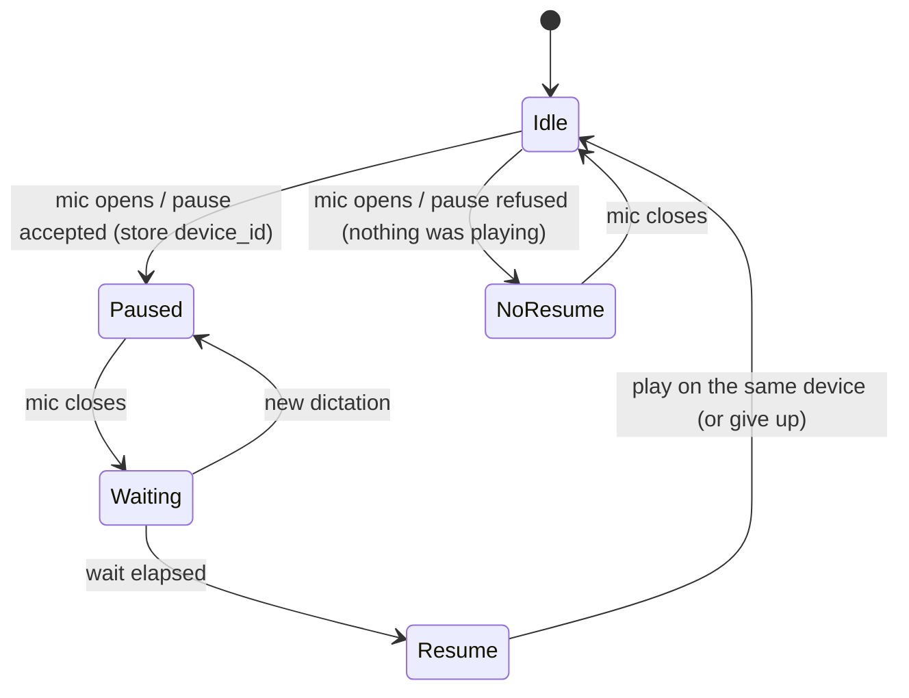

# Spec — Automatic Spotify pause during dictation (Wispr Flow)

Version of 2026-11-27 · Author: Danilo Recchia

## 1. Goal and scope

A Windows tray utility pauses Spotify when Wispr Flow starts listening and resumes playback, on the same device, when dictation ends. Working name: `flowpause`.

Flow's native feature sends a local media command. When the Spotify app on the PC only controls playback on another device (Echo Dot via Spotify Connect), there is no local audio session and nothing gets paused. The Spotify Web API reaches every device on the account.

**In scope**

- Detect the start and end of Wispr Flow dictation on Windows 11.
- Pause the account's active Spotify playback, whether on the PC, the Echo, or another Connect device.
- Automatically resume on the device that was playing before the pause.
- Run in the background, with a tray icon, starting with Windows.

**Out of scope**

- Other players (YouTube, browser, Apple Music).
- Other operating systems.
- Other dictation software. The target is configurable, but only Wispr Flow is tested.
- Lowering the volume instead of pausing.

## 2. Architecture decisions

The program is a single Rust binary, with no window, made of three components that talk over async channels.

| Component | Responsibility |
| --- | --- |
| Detector | Watches the Windows registry and emits `DictationStarted` and `DictationEnded` |
| Controller | State machine: decides when to pause, when to resume, and on which device |
| Spotify client | Authentication, token refresh, and Web API calls |

**Why Rust:** a resident process with minimal memory use, a single binary with no runtime, and direct access to the Windows API through the `windows` crate.

**Suggested crates** (to be confirmed during implementation): `tokio` for the runtime, `reqwest` for HTTP, `windows` or `winreg` for the registry, `tray-icon` for the tray, `keyring` to store the refresh token in Windows Credential Manager, `serde` + `toml` for configuration, `tracing` for logging.

**Rejected options**

- Detecting through Flow's bottom bar (UI Automation): depends on interface details that change with every update.
- Global hotkey hook: does not cover hands-free mode and breaks if the shortcut changes.
- Media key or Windows media session to pause: does not reach the Echo.

## 3. Dictation detection

The trigger is microphone use by the Wispr Flow process, read from the Windows registry. A test on 2026-11-27 confirmed that Flow only opens the microphone during dictation: the privacy screen shows "Currently in use" while it listens and goes back to showing the last access time when it stops.
**Signal source**

- Key: `HKCU\Software\Microsoft\Windows\CurrentVersion\CapabilityAccessManager\ConsentStore\microphone\NonPackaged`
- Each desktop app has a subkey named after the executable path, with `#` instead of `\`.
- Values: `LastUsedTimeStart` and `LastUsedTimeStop` (QWORD, FILETIME format).
- In use: `LastUsedTimeStop` equal to 0. Released: `LastUsedTimeStop` holds a timestamp.

**Rules**

1. At startup, enumerate the subkeys and select those matching the configured pattern (default: name containing `wispr`, case-insensitive). There are two "Wispr Flow" entries today; every matching entry is watched.
2. Register `RegNotifyChangeKeyValue` on the `NonPackaged` key, with subtree and `REG_NOTIFY_CHANGE_LAST_SET`. No polling.
3. On each notification, reread the selected subkeys. Dictation is active if any of them has `LastUsedTimeStop` equal to 0.
4. Emit an event only on a transition (inactive to active, active to inactive).
5. Re-enumerate the subkeys on each notification, because a Flow update can create a new entry with a different path.
6. At startup, if the microphone is already in use, treat it as dictation in progress.

If Flow becomes a packaged app (MSIX), the entry moves to `ConsentStore\microphone\<PackageFamilyName>`. The detector should watch the whole `microphone` key to cover both cases.

## 4. Spotify integration

Every playback action goes through the Spotify Web API, which requires a Premium account and controls any Spotify Connect device on the account.

**App in the developer dashboard**

- One app in Development Mode, created by the user. Since February 2026 this mode requires the owner to have Premium, allows one Client ID per developer, and up to five authorized users. That is enough for personal use.
- Loopback redirect URI: `http://127.0.0.1:<port>/callback`.
- The Client ID goes in the configuration file. There is no client secret.

**Authentication**

- Authorization Code with PKCE. On first run the program opens the browser and starts a local HTTP server only to receive the callback.
- Scopes: `user-read-playback-state` and `user-modify-playback-state`.
- Refresh token stored in Windows Credential Manager, never in a file.
- Access token refreshed in the background before it expires, so a pause never waits for a refresh.

**Endpoints**

| Use | Call |
| --- | --- |
| Pause | `PUT /v1/me/player/pause` |
| Read state and device | `GET /v1/me/player` |
| Resume on device | `PUT /v1/me/player/play?device_id=<id>` |
| Reactivate a device that left the list | `PUT /v1/me/player` with `device_ids` and `play: true` |

**Latency:** keep the HTTPS connection to `api.spotify.com` warm (keep-alive), so the pause does not pay for the TLS handshake.

## 5. State machine

The controller pauses first and asks later: the pause response tells whether music was playing, and only then is there a resume.

A new dictation during the wait goes back to Paused without sending a command. If nothing was playing, the program just waits for dictation to end.

**When the microphone opens**

1. Send `pause` immediately, with no prior check, to avoid adding latency.
2. Success (200 or 204): music was playing. Call `GET /v1/me/player` and store `device.id`, `device.name`, and the pause time.
3. Refusal (403): nothing was playing. Mark the cycle as no-resume.

**When the microphone closes**

1. Start waiting `resume_delay_ms`.
2. If the microphone opens again before the wait ends, cancel the wait and go back to Paused.

**When the wait ends**

1. If the pause lasted longer than `max_pause_secs`, do not resume.
2. Call `GET /v1/me/player`. If `is_playing` is true or the active device differs from the stored one, do not resume.
3. Send `play` with the stored `device_id`.
4. On 404, try one playback transfer to the same `device_id` with `play: true`.
5. Clear the stored state and go back to Idle.

The stored `device_id` is the only source for resuming. The program never picks "the active device" or a default device.

## 6. Edge cases and errors

The general rule is to fail silently and never play music the user was not listening to. Every error goes to the log; none opens a window.

| Situation | Behavior |
| --- | --- |
| Nothing playing when dictation starts | Spotify refuses the pause; the program does not resume afterwards |
| Back-to-back dictations | A new dictation during the wait cancels the resume; the music stays paused |
| User presses play manually during the pause | At resume time the state is already playing; the program does nothing |
| User switches devices during the pause | The active device differs from the stored one; the program does not resume |
| Stored device left the list (404 on play) | One transfer attempt with `play: true` to the same `device_id`; if it fails, give up |
| Long dictation, above the configured limit | No automatic resume |
| No network or timeout on pause | One immediate retry; if it fails, carry on without pausing |
| 401 on any call | Refresh the token and repeat the call once |
| 429 (rate limit) | Honor `Retry-After`; drop the action if the delay exceeds 2 s |
| Refresh token revoked | Tray icon shows "reconnect"; new authorization from the menu |
| Program exits with music it paused | Tries to resume before exiting |
| Restricted device (does not accept API commands) | Warning in the log; no action |

The latency between the microphone opening and the music stopping is between 0.3 and 1 s on the Echo. The start of speech may catch a bit of music, and that is accepted.

## 7. Configuration and tray

Configuration lives in `%APPDATA%\flowpause\config.toml`, created with defaults on first run.

| Key | Default | Meaning |
| --- | --- | --- |
| `spotify_client_id` | empty | Client ID of the app in the Spotify dashboard |
| `redirect_port` | 8888 | Loopback OAuth callback port |
| `process_match` | `wispr` | Part of the executable name watched in the registry |
| `resume_delay_ms` | 2000 | Wait between the end of dictation and the resume |
| `max_pause_secs` | 300 | Above this, the automatic resume is canceled |
| `autostart` | true | Start with Windows |
| `log_level` | `info` | Log level |

**Tray menu**

- Enabled / Paused (turns the behavior on and off without closing the program)
- Connect to Spotify / Reconnect
- Start with Windows
- Open logs folder
- Exit

The icon has three states: active, disabled, and not connected to Spotify. Autostart uses the user's `Run` key in the registry. A second instance exits when it detects the first (named mutex). Logs go to `%LOCALAPPDATA%\flowpause\logs`, with daily rotation.

## 8. Delivery phases

Phase 0 is a gate: if the Echo does not accept Web API commands, the project stops and the approach is reviewed before writing the rest.

| Phase | Deliverable | Done when |
| --- | --- | --- |
| 0. Echo validation | Minimal CLI: PKCE login, `status`, `pause`, `play --device <id>` | With music on the Echo, `pause` and `play` work and `status` shows the Echo with `is_restricted: false` |
| 1. Detector | Registry watcher that prints events to the console | Each dictation produces exactly one start and one end, with no false positive across 20 dictations |
| 2. Controller | State machine wiring the detector and the Spotify client | Acceptance criteria 1 to 6 pass in console mode |
| 3. Finishing | Tray, configuration, autostart, logs, single instance | All acceptance criteria pass with the release binary |

In phase 0, also record the time between the command and silence on the Echo, and how long the Echo stays in the device list after being paused.

## 9. Acceptance criteria

Each item is a manual test with an observable result.

- [ ] 1. Music on the Echo Dot: when dictation starts it stops within 1 s; when dictation ends, it comes back on the Echo about 2 s later.
- [ ] 2. Music in Spotify on the PC: same behavior, resuming on the PC.
- [ ] 3. Nothing playing: dictating does not start music on any device.
- [ ] 4. Three dictations less than 2 s apart: the music stops once and comes back once, at the end of the third.
- [ ] 5. Manual play during the pause: the program sends no command when dictation ends.
- [ ] 6. Device switch during the pause: the program does not resume on the old device.
- [ ] 7. Windows restart: the program starts on its own and works without a new Spotify login.
- [ ] 8. No internet: dictating does not freeze or delay Wispr Flow, and the error shows up in the log.
- [ ] 9. At rest: less than 15 MB of memory and 0% CPU.
- [ ] 10. "Disabled" in the tray menu: dictating does not pause the music.

## 10. Risks and open questions

The only risk that would make the project unviable is the first one, and phase 0 exists to settle it.

| Risk | Impact | How to validate or mitigate |
| --- | --- | --- |
| Echo Dot refuses Web API commands (restricted device) | Project unviable this way | Phase 0. Not confirmed so far |
| Spotify's response to pausing an already paused player is not 403 | Detecting "was playing" fails | Phase 0. Alternative: read the state before pausing, at a latency cost |
| Echo leaves the device list after a pause | Resume fails after long dictations | Measure in phase 0; fallback via playback transfer |
| A Flow update keeps the microphone always open | Trigger stops working | Detector isolated behind an interface; hotkey or UI Automation as an alternative source |
| Spotify restricts player endpoints in Development Mode | Pause and resume stop working | No technical mitigation; follow Spotify for Developers announcements |
| Registry key format changes in a future Windows version | Detector stops | Alternative: WASAPI capture sessions |

**Note of 2026-11-27 (phase 1):** section 3 says there are two "Wispr Flow" entries. In fact, `NonPackaged` has 86 subkeys containing `wispr`, one per installed Flow version (for example, `C:#Users#<user>#AppData#Local#WisprFlow#app-1.6.1583#Wispr Flow.exe`). Each update creates a new entry, and the old ones remain. The detector follows the section 3 rule: it watches all of them and treats dictation as active if any has `LastUsedTimeStop` equal to 0. New risk: if an old entry gets stuck with `LastUsedTimeStop` equal to 0 (for example, if Flow is killed during a dictation), the detector stays active forever. Not observed yet.

**Note of 2026-11-27 (phase 1, `watch` test): the registry stopped being updated.** Over 5 dictations, `flowpause watch` emitted no events. Diagnosis:

- The last write of `LastUsedTimeStart`/`LastUsedTimeStop` anywhere in `CapabilityAccessManager` (HKCU and HKLM, any app, any permission) was on 2026-11-24 at 07:36.
- Updates KB5132061 and KB5132688 were installed on 2026-11-24. Windows is on build 26300.9974 (26H2).
- The Wispr Flow in use is `app-1.6.1631`, installed on 2026-11-26, and it has no subkey under `NonPackaged`. The newest version in the registry is 1.6.1583, last used on 2026-11-23.
- The folder `C:\ProgramData\Microsoft\Windows\CapabilityAccessManager` exists, but only administrators can access it.

Conclusion: on this Windows build, the section 3 signal source no longer works. The risk "Registry key format changes in a future Windows version" happened. The alternative already listed in this table is to watch audio capture sessions through WASAPI.

Decision (2026-11-27, approved by the author): the detector now uses WASAPI. It watches the capture sessions of every active microphone (`IAudioSessionManager2`, with notifications for new sessions and state changes) and filters by the process executable path (default `wispr`). Dictation is active if any matching session is in `AudioSessionStateActive`. It also reacts to microphones being connected or removed. Rules 4 and 6 of section 3 still apply: events only on transitions, and dictation already in progress at startup produces a start event. Section 3 describes the old source and stays as history.

## References

- [Spotify Web API: Pause Playback](https://developer.spotify.com/console/put-pause)
- [Spotify for Developers: Update on Developer Access and Platform Security, 2026-02-06](https://developer.spotify.com/blog/2026-02-06-update-on-developer-access-and-platform-security)
- [Wispr Flow: auto-mute and media pause during dictation](https://docs.wisprflow.ai/articles/7231650589-auto-mute-music-while-dictating-on-macos-how-audio-detection-works)
