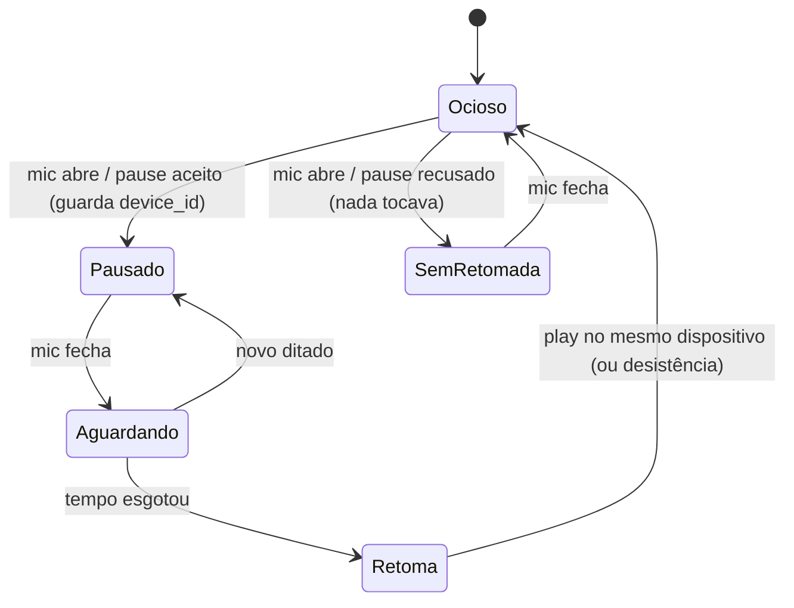

# Spec — Pausa automática do Spotify durante ditado (Wispr Flow)

Versão de 27/11/2026 · Autor: Danilo Recchia

## 1. Objetivo e escopo

Um utilitário de bandeja para Windows pausa o Spotify quando o Wispr Flow começa a ouvir e retoma a reprodução, no mesmo dispositivo, quando o ditado termina. Nome provisório: `flowpause`.

O recurso nativo do Flow envia um comando de mídia local. Quando o Spotify do PC só controla a reprodução em outro dispositivo (Echo Dot via Spotify Connect), não há sessão de áudio local e nada é pausado. A Web API do Spotify alcança qualquer dispositivo da conta.

**Dentro do escopo**

- Detectar início e fim do ditado do Wispr Flow no Windows 11.
- Pausar a reprodução ativa da conta Spotify, seja no PC, no Echo ou em outro dispositivo Connect.
- Retomar automaticamente no dispositivo que estava tocando antes da pausa.
- Rodar em segundo plano, com ícone na bandeja e início junto com o Windows.

**Fora do escopo**

- Outros players (YouTube, navegador, Apple Music).
- Outros sistemas operacionais.
- Outros softwares de ditado. O alvo é configurável, mas só o Wispr Flow é testado.
- Reduzir volume em vez de pausar.

## 2. Decisões de arquitetura

O programa é um binário único em Rust, sem janela, com três componentes que conversam por canais assíncronos.

| Componente | Responsabilidade |
| --- | --- |
| Detector | Observa o registro do Windows e emite `DitadoIniciou` e `DitadoTerminou` |
| Controlador | Máquina de estados: decide quando pausar, quando retomar e em qual dispositivo |
| Cliente Spotify | Autenticação, renovação de token e chamadas à Web API |

**Por que Rust:** processo residente com consumo mínimo de memória, binário único sem runtime e acesso direto à API do Windows pelo crate `windows`.

**Crates sugeridos** (a confirmar na implementação): `tokio` para o runtime, `reqwest` para HTTP, `windows` ou `winreg` para o registro, `tray-icon` para a bandeja, `keyring` para guardar o refresh token no Gerenciador de Credenciais do Windows, `serde` + `toml` para configuração, `tracing` para log.

**Decisões descartadas**

- Detectar pela barra inferior do Flow (UI Automation): depende de detalhes da interface que mudam a cada atualização.
- Hook global da hotkey: não cobre o modo hands-free e quebra se o atalho mudar.
- Tecla de mídia ou sessão de mídia do Windows para pausar: não alcança o Echo.

## 3. Detecção do ditado

O gatilho é o uso do microfone pelo processo do Wispr Flow, lido do registro do Windows. Teste em 27/11/2026 confirmou que o Flow só abre o microfone durante o ditado: a tela de privacidade mostra "Atualmente em uso" enquanto ele ouve e volta a mostrar o horário do último acesso quando para.

**Fonte do sinal**

- Chave: `HKCU\Software\Microsoft\Windows\CurrentVersion\CapabilityAccessManager\ConsentStore\microphone\NonPackaged`
- Cada aplicativo desktop tem uma subchave com o caminho do executável, com `#` no lugar de `\`.
- Valores: `LastUsedTimeStart` e `LastUsedTimeStop` (QWORD, formato FILETIME).
- Em uso: `LastUsedTimeStop` igual a 0. Liberado: `LastUsedTimeStop` com timestamp.

**Regras**

1. Na inicialização, enumerar as subchaves e selecionar as que casam com o padrão configurado (padrão: nome contendo `wispr`, sem diferenciar maiúsculas). Hoje existem duas entradas "Wispr Flow"; todas as que casarem são observadas.
2. Registrar `RegNotifyChangeKeyValue` na chave `NonPackaged`, com subtree e `REG_NOTIFY_CHANGE_LAST_SET`. Sem polling.
3. A cada notificação, reler as subchaves selecionadas. O ditado está ativo se qualquer uma tiver `LastUsedTimeStop` igual a 0.
4. Emitir evento só na transição (inativo para ativo, ativo para inativo).
5. Reenumerar as subchaves a cada notificação, porque uma atualização do Flow pode criar uma entrada nova com outro caminho.
6. Na inicialização, se o microfone já estiver em uso, tratar como ditado em andamento.

Se o Flow passar a ser distribuído como app empacotado (MSIX), a entrada muda para `ConsentStore\microphone\<PackageFamilyName>`. O detector deve observar a chave `microphone` inteira para cobrir os dois casos.

## 4. Integração com o Spotify

Toda ação de reprodução passa pela Web API do Spotify, que exige conta Premium e controla qualquer dispositivo Spotify Connect da conta.

**App no painel de desenvolvedor**

- Um app em Development Mode, criado pelo próprio usuário. Desde fevereiro de 2026 esse modo exige Premium do dono, permite um Client ID por desenvolvedor e até cinco usuários autorizados. Para uso pessoal basta.
- Redirect URI em loopback: `http://127.0.0.1:<porta>/callback`.
- O Client ID vai no arquivo de configuração. Não há client secret.

**Autenticação**

- Authorization Code com PKCE. Na primeira execução o programa abre o navegador e sobe um servidor HTTP local só para receber o callback.
- Escopos: `user-read-playback-state` e `user-modify-playback-state`.
- Refresh token guardado no Gerenciador de Credenciais do Windows, nunca em arquivo.
- Access token renovado em segundo plano antes de expirar, para a pausa nunca esperar uma renovação.

**Endpoints**

| Uso | Chamada |
| --- | --- |
| Pausar | `PUT /v1/me/player/pause` |
| Ler estado e dispositivo | `GET /v1/me/player` |
| Retomar no dispositivo | `PUT /v1/me/player/play?device_id=<id>` |
| Reativar dispositivo que saiu da lista | `PUT /v1/me/player` com `device_ids` e `play: true` |

**Latência:** manter a conexão HTTPS com `api.spotify.com` aquecida (keep-alive), para a pausa não pagar o handshake TLS.

## 5. Máquina de estados

O controlador pausa primeiro e pergunta depois: a resposta da pausa diz se havia música, e só nesse caso existe retomada.

Um novo ditado durante a espera volta para Pausado sem enviar comando. Se nada estava tocando, o programa apenas aguarda o fim do ditado.

**Ao abrir o microfone**

1. Enviar `pause` imediatamente, sem consulta prévia, para não somar latência.
2. Sucesso (200 ou 204): havia música. Chamar `GET /v1/me/player` e guardar `device.id`, `device.name` e o horário da pausa.
3. Recusa (403): nada estava tocando. Marcar o ciclo como sem retomada.

**Ao fechar o microfone**

1. Iniciar a espera de `resume_delay_ms`.
2. Se o microfone abrir de novo antes do fim, cancelar a espera e voltar a Pausado.

**Ao fim da espera**

1. Se a pausa durou mais que `max_pause_secs`, não retomar.
2. Chamar `GET /v1/me/player`. Se `is_playing` for verdadeiro ou o dispositivo ativo for diferente do guardado, não retomar.
3. Enviar `play` com o `device_id` guardado.
4. Em 404, tentar uma transferência de reprodução para o mesmo `device_id` com `play: true`.
5. Limpar o estado guardado e voltar a Ocioso.

O `device_id` guardado é a única fonte para a retomada. O programa nunca escolhe "o dispositivo ativo" nem um dispositivo padrão.

## 6. Casos de borda e erros

A regra geral é falhar em silêncio e nunca tocar música que o usuário não estava ouvindo. Todo erro vai para o log; nenhum abre janela.

| Situação | Comportamento |
| --- | --- |
| Nada tocando quando o ditado começa | A pausa é recusada pelo Spotify; o programa não retoma depois |
| Ditados em sequência | Novo ditado durante a espera cancela a retomada; a música segue pausada |
| Usuário dá play manualmente durante a pausa | Na retomada o estado já está tocando; o programa não faz nada |
| Usuário troca de dispositivo durante a pausa | O dispositivo ativo difere do guardado; o programa não retoma |
| Dispositivo guardado saiu da lista (404 no play) | Uma tentativa de transferência com `play: true` para o mesmo `device_id`; se falhar, desiste |
| Ditado longo, acima do limite configurado | Não retoma automaticamente |
| Sem rede ou timeout na pausa | Uma nova tentativa imediata; se falhar, segue sem pausar |
| 401 em qualquer chamada | Renova o token e repete a chamada uma vez |
| 429 (rate limit) | Respeita `Retry-After`; descarta a ação se o atraso passar de 2 s |
| Refresh token revogado | Ícone da bandeja indica "reconectar"; nova autorização pelo menu |
| Programa encerrado com música pausada por ele | Tenta retomar antes de sair |
| Dispositivo restrito (não aceita comandos da API) | Log de aviso; sem ação |

A latência entre o microfone abrir e a música parar fica entre 0,3 e 1 s no Echo. O início da fala pode pegar um resto de música, e isso é aceito.

## 7. Configuração e bandeja

A configuração fica em `%APPDATA%\flowpause\config.toml`, criada com os padrões na primeira execução.

| Chave | Padrão | Significado |
| --- | --- | --- |
| `spotify_client_id` | vazio | Client ID do app no painel do Spotify |
| `redirect_port` | 8888 | Porta do callback OAuth em loopback |
| `process_match` | `wispr` | Trecho do nome do executável observado no registro |
| `resume_delay_ms` | 2000 | Espera entre o fim do ditado e a retomada |
| `max_pause_secs` | 300 | Acima disso a retomada automática é cancelada |
| `autostart` | true | Iniciar com o Windows |
| `log_level` | `info` | Nível de log |

**Menu da bandeja**

- Ativado / Pausado (liga e desliga o comportamento sem fechar o programa)
- Conectar ao Spotify / Reconectar
- Iniciar com o Windows
- Abrir pasta de logs
- Sair

O ícone tem três estados: ativo, desativado e sem conexão com o Spotify. O início automático usa a chave `Run` do usuário no registro. Uma segunda instância encerra ao detectar a primeira (mutex nomeado). Logs em `%LOCALAPPDATA%\flowpause\logs`, com rotação diária.

## 8. Fases de entrega

A fase 0 é um portão: se o Echo não aceitar comandos pela Web API, o projeto para e a abordagem é revista antes de escrever o resto.

| Fase | Entrega | Pronto quando |
| --- | --- | --- |
| 0. Validação do Echo | CLI mínima: login PKCE, `status`, `pause`, `play --device <id>` | Com a música no Echo, `pause` e `play` funcionam e `status` mostra o Echo com `is_restricted: false` |
| 1. Detector | Observador do registro que imprime os eventos no console | Cada ditado gera exatamente um início e um fim, sem falso positivo em 20 ditados |
| 2. Controlador | Máquina de estados ligando detector e cliente Spotify | Os critérios de aceite 1 a 6 passam em modo console |
| 3. Acabamento | Bandeja, configuração, início automático, logs, instância única | Todos os critérios de aceite passam com o binário de release |

Na fase 0, registrar também o tempo entre o comando e o silêncio no Echo, e por quanto tempo o Echo continua na lista de dispositivos depois de pausado.

## 9. Critérios de aceite

Cada item é um teste manual com resultado observável.

- [ ] 1. Música no Echo Dot: ao iniciar o ditado ela para em até 1 s; ao terminar, volta no Echo cerca de 2 s depois.
- [ ] 2. Música no Spotify do PC: mesmo comportamento, com retomada no PC.
- [ ] 3. Nada tocando: ditar não inicia música em nenhum dispositivo.
- [ ] 4. Três ditados com menos de 2 s entre eles: a música para uma vez e volta uma vez, ao final do terceiro.
- [ ] 5. Play manual durante a pausa: o programa não envia comando ao terminar o ditado.
- [ ] 6. Troca de dispositivo durante a pausa: o programa não retoma no dispositivo antigo.
- [ ] 7. Reinício do Windows: o programa sobe sozinho e funciona sem novo login no Spotify.
- [ ] 8. Sem internet: ditar não trava nem atrasa o Wispr Flow, e o erro aparece no log.
- [ ] 9. Em repouso: menos de 15 MB de memória e 0% de CPU.
- [ ] 10. "Desativado" no menu da bandeja: ditar não pausa a música.

## 10. Riscos e pontos a validar

O único risco que inviabiliza o projeto é o primeiro, e a fase 0 existe para resolvê-lo.

| Risco | Impacto | Como validar ou mitigar |
| --- | --- | --- |
| Echo Dot recusar comandos da Web API (dispositivo restrito) | Projeto inviável por essa via | Fase 0. Não confirmado até aqui |
| Resposta do Spotify ao pausar o que já está pausado não ser 403 | A detecção de "estava tocando" falha | Fase 0. Alternativa: ler o estado antes de pausar, com custo de latência |
| Echo sair da lista de dispositivos após pausa | Retomada falha em ditados longos | Medir na fase 0; fallback por transferência de reprodução |
| Atualização do Flow manter o microfone sempre aberto | Gatilho deixa de funcionar | Detector isolado atrás de uma interface; hotkey ou UI Automation entram como fonte alternativa |
| Spotify restringir os endpoints de player em Development Mode | Pausa e retomada param | Sem mitigação técnica; acompanhar os anúncios do Spotify for Developers |
| Formato da chave de registro mudar em versão futura do Windows | Detector para | Alternativa: sessões de captura via WASAPI |

**Nota de 27/11/2026 (fase 1):** a seção 3 diz que existem duas entradas "Wispr Flow". Na verdade, `NonPackaged` tem 86 subchaves com `wispr`, uma por versão instalada do Flow (por exemplo, `C:#Users#<usuario>#AppData#Local#WisprFlow#app-1.6.1583#Wispr Flow.exe`). Cada atualização cria uma entrada nova, e as antigas ficam. O detector segue a regra da seção 3: observa todas e considera o ditado ativo se qualquer uma tiver `LastUsedTimeStop` igual a 0. Risco novo: se uma entrada antiga ficar presa com `LastUsedTimeStop` igual a 0 (por exemplo, se o Flow for encerrado à força durante um ditado), o detector fica sempre ativo. Ainda não foi observado.

## Referências

- [Spotify Web API: Pause Playback](https://developer.spotify.com/console/put-pause)
- [Spotify for Developers: Update on Developer Access and Platform Security, 6 fev 2026](https://developer.spotify.com/blog/2026-02-06-update-on-developer-access-and-platform-security)
- [Wispr Flow: auto-mute e pausa de mídia durante o ditado](https://docs.wisprflow.ai/articles/7231650589-auto-mute-music-while-dictating-on-macos-how-audio-detection-works)
